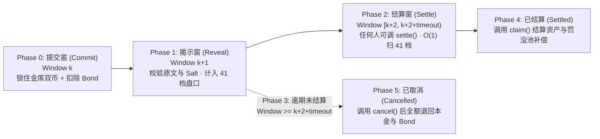

# FairBatch (SealBatch) — Monad 链上密封集合竞价交易协议

> **秒级流水线 · 锁仓隐藏买卖方向 · 一次授权的链上统一清算价集合竞价原型**  
> Built on Monad Testnet · 规则链上可复核 · 无需信任私人撮合方 · 完备异常退出路径

---

## 📌 0. 项目定位与可证伪假设

在高频或流动性集中涌入同一交易对的场景下，传统即时兑换（AMM）或明文限价订单簿容易面临抢跑、报价滑点或排序博弈。**FairBatch（合约实现名：`SealBatch`）** 旨在 Monad 测试网上验证一个清晰、可证伪的产品假设：

> **当同一交易对短时间内涌入多笔买卖订单时，部分重视价格边界的交易者愿意用短暂的批次等待（Commit $\rightarrow$ Reveal $\rightarrow$ Settle），换取：**
>
> 1. **事先可知的价格边界**（买不高于限价、卖不低于限价）；
> 2. **同轮统一清算成交价（Uniform Clearing Price）与提交顺序无关的分配**；
> 3. **无需信任中心化/私人 Solver 的纯链上确定性清算**；
> 4. **任何异常情况下（无对手、未揭示、逾期无人结算）可按公开规则安全取回本金。**

---

## 🛡️ 1. 产品承诺与诚实边界声明

### 对用户的明确承诺

1. **严格价格边界保护**：买入成交价绝不高于用户设定的最高买价档位；卖出成交价绝不低于用户设定的最低卖价档位。
2. **同批统一清算价**：同一批次内所有撮合成交的订单均按同一个清算价格（`priceTick`）结算；买家省下的预算差额与部分成交的剩余本金全部退回金库余额。
3. **全链上无特权清算**：清算规则、批次状态、资金托管与分配在链上公开可复核；团队无权单方面挑选成交者或冻结/批准提款；**任何地址均可触发结算（`settle`）或代领回金库（`claim`），仅用户本人可从金库提现（`withdraw`）**。
4. **完备本金退出路径**：无对手盘零成交、或逾期无人结算触发整轮取消（`cancel`）时，用户均可按规则全额取回锁定本金（注：已消耗的链上交易 Gas 不退还）。

### 机制边界与诚实声明（不作虚假承诺）

- **不宣称“零知识级绝对保密”或“彻底消除 MEV”**：哈希承诺（Commit Hash）不是加密。本合约通过**内置金库全额双币锁仓**隐藏了提交阶段的买卖方向与下单数量，但参与者的地址与金库总余额仍链上可见，且进入揭示（Reveal）阶段后订单原文即公开。
- **弃标博弈与保证金（`bond`）说明**：提交承诺时需冻结固定保证金 `bond`（默认 `1 SUSD`）。按时揭示全额退还 `bond`；若漏揭示或故意弃标，`bond` 将被罚没进入 `slashPool` 并按成交量补偿给本轮成交者（若整轮超时无人结算被取消，则 `bond` 全额退还）。尽管有保证金约束，当极端行情波动超过 `bond` 价值时仍存在策略性弃标空间。
- **不宣称“零滑点”或“必成交”**：仅当同批次有效揭示的买单限价与卖单限价存在价格交叉时才会产生成交。

---

## ⚙️ 2. 核心工程机制与清算规格 (`SealBatch.sol`)

### 2.1 内置金库、一键入场 (`onboard`) 与会话密钥 (`sessionKey`)

为解决传统 Commit-Reveal 需要多次 ERC-20 `approve` 与频繁弹窗签名的痛点，[`SealBatch.sol`](contracts/src/SealBatch.sol) 实现了：

- **一次签名完成入场 (`onboard(address key)`)**：自动领取测试币（`10 SBA` + `1000 SUSD`）直接进入用户在合约内的金库余额（`freeBase` / `freeQuote`），同时绑定临时会话密钥 `sessionKey` 并顺带转入少量原生币作为 Gas。
- **权限最小化隔离**：`sessionKey` **仅被授权执行 `commit` 和 `reveal`**，无权调用 `withdraw` 提走资金；`claim` 任何人均可触发（资金仅回到 `owner` 的合约金库内），只有 `owner` 主钱包本人能调用 `withdraw` 提现到外部钱包。
- **双币全锁隐藏买卖方向**：调用 `commit` 时，合约将用户金库中 `freeBase` 与 `freeQuote - bond` 全部转为批次锁仓状态（`lockedBase` / `lockedQuote`）。因此**在提交阶段，链上观察者无法从锁仓币种或数额判断该笔订单是买单还是卖单**。

---

### 2.2 流水线批次与四阶段生命周期

合约以区块窗口 `windowBlocks` 为单位划分流水线批次：`currentWindow() = (block.number - genesisBlock) / windowBlocks`。对于任意批次 `batchId = k`：



1. **提交窗 (`phase = 0`, Window $k$)**
   - 计算承诺哈希：  
     $\text{commitHash} = \text{keccak256}\big(\text{abi.encode}(\text{contractAddr}, \text{chainId}, \text{batchId}, \text{owner}, \text{isBuy}, \text{qty}, \text{tick}, \text{salt})\big)$
   - 校验 `freeQuote[owner] >= bond`，锁定全部可用 `freeBase` 与 `freeQuote - bond`，每地址每批次限提交 1 笔。
2. **揭示窗 (`phase = 1`, Window $k+1$)**
   - 校验承诺哈希、`tick < 41` 及最小数量 `qty >= MIN_QTY (0.001 SBA)`。
   - 校验锁仓充足性：买单需满足 $\lceil \text{qty} \times \text{price}(\text{tick}) \rceil \le \text{lockedQuote}$，卖单需满足 $\text{qty} \le \text{lockedBase}$。
   - 验证通过后将 `qty` 累加至对应价格档位 `_buyAt[batchId][tick]` 或 `_sellAt[batchId][tick]`。
3. **结算窗 (`phase = 2`, Window $[k+2, k+2+\text{timeoutWindows})$)**
   - 任何地址均可调用 `settle(batchId)` 完成统一价清算。
   - 未揭示订单的 `bond` 汇总进入本批罚没池：`slashPool = (commits - reveals) * bond`。
4. **超时取消 (`phase = 3`, Window $\ge k+2+\text{timeoutWindows}$)**
   - 若宽限期内无人调用 `settle`，任何地址可调用 `cancel(batchId)` 触发整轮取消（与 `settle` 严格互斥），所有参与者全额拿回 `lockedBase`、`lockedQuote` 及 `bond`。

---

### 2.3 固定 41 档价格刻度与 $O(1)$ 确定性统一清算价

合约采用固定 41 个离散价格档位（`NUM_TICKS = 41`，档位索引 $t \in [0, 40]$），结算时仅扫描 41 个档位，**Gas 消耗恒定，与参与订单数量无关**：

$\text{price}(t) = P_0 + \text{STEP} \times t = 90 + 0.5t \quad (\text{SUSD / SBA},\; \text{范围 } 90.0 \sim 110.0)$

对每个档位 $t \in [0, 40]$：

- **累计可买量 $D[t]$**：所有买方限价档位 $\ge t$ 的已揭示买单总量 $\sum_{i=t}^{40} \text{buyAt}[i]$
- **累计可卖量 $S[t]$**：所有卖方限价档位 $\le t$ 的已揭示卖单总量 $\sum_{i=0}^{t} \text{sellAt}[i]$
- **可撮合成交量 $V[t]$**：$V[t] = \min(D[t],\; S[t])$

**候选价集合与平局决胜规则（Tie-Breaking）**：

1. **有限候选价格集**：仅考虑本批次有实际揭示订单的去重价格档位（即 $\text{buyAt}[t] > 0$ 或 $\text{sellAt}[t] > 0$ 的档位 $t$）。
2. 选出使 $V[t]$ 最大的候选档位；若 $\max V[t] = 0$，则本批次零成交。
3. 若存在 `nTie` 个候选档位并列最大成交量，按档位从低到高排序，取索引为 `(nTie - 1) / 2` 的候选档位作为唯一清算档位 `priceTick`（即**取中位候选价，数量为偶数时取中间较低者**）。

---

### 2.4 价格优先、边际档按比例分配（Pro-Rata）与资产守恒

当清算档位为 $p = \text{priceTick}$、总成交量为 $V = \text{volume} > 0$ 时：

- **价格优先与边际档位按比例分配（`fillOf`）**：
  - 若买方过量（$D[p] > S[p]$，`rationedSide = 1`）：从最高买价档位往下逐档 100% 成交，直至触及边际档位 `marginalTick`；高于 `marginalTick` 的买单全额成交，处于 `marginalTick` 的买单按比例 $\lfloor \text{qty} \times r_{\text{num}} / r_{\text{den}} \rfloor$ 成交，低于 `marginalTick` 的买单不成交。
  - 若卖方过量（$S[p] > D[p]$，`rationedSide = 2`）：从最低卖价档位往上逐档 100% 成交，直至触及边际档位 `marginalTick`；低于 `marginalTick` 的卖单全额成交，处于 `marginalTick` 的卖单按比例 $\lfloor \text{qty} \times r_{\text{num}} / r_{\text{den}} \rfloor$ 成交，高于 `marginalTick` 的卖单不成交。
- **手续费覆盖舍入尾差与罚没池分红（`previewClaim`）**：
  - 买方实际支出严格向上取整 $\lceil \text{fill} \times \text{price}(p) / 10^{18} \rceil$，获得基础资产 $\text{fill} \times (10000 - \text{feeBps}) / 10000$；
  - 卖方支出基础资产 $\text{fill}$，获得报价资产 $(\text{fill} \times \text{price}(p) / 10^{18}) \times (10000 - \text{feeBps}) / 10000$；
  - 配合最小下单量 `MIN_QTY = 0.001 SBA` 与 `feeBps`（默认 `5 bps`），确保留在合约内的极小手续费完全覆盖整数除法舍入尾差，合约资产恒满足：**合约实际余额 $\ge$ 所有用户可提取余额之和**。
  - 若本批次存在未揭示弃标者（`slashPool > 0`），每位成交者额外获得报价资产补偿：$\lfloor \text{slashPool} \times \text{fill} / (2 \times \text{volume}) \rfloor$。

---

## 🗂️ 3. 仓库结构与快速运行

```text
FairBatch/
├── abi/                        # 导出的智能合约 ABI (供前端与参考模型直接调用)
│   ├── SealBatch.json
│   └── MockToken.json
├── contracts/                  # Foundry 智能合约工程
│   ├── src/
│   │   ├── SealBatch.sol       # 密封集合竞价核心合约 (Vault / SessionKey / Commit-Reveal / Settle)
│   │   └── MockToken.sol       # 测试网 ERC-20 代币合约 (SBA / SUSD)
│   ├── test/
│   │   └── SealBatch.t.sol     # 完整单元测试与 Fuzz 测试 (正常/部分成交/平局/顺序无关/守恒/弃标/超时)
│   ├── script/
│   │   └── Deploy.s.sol        # Monad Testnet 部署脚本
│   └── foundry.toml
└── README.md
```

### 运行合约测试与验证

[`contracts/test/SealBatch.t.sol`](contracts/test/SealBatch.t.sol) 已内置对 PRD 核心验收项的自动化验证（包括正常交叉 `test_simpleCross`、买卖边际配给 `test_buyRationed` / `test_sellRationed`、无交叉全额退款 `test_noCross_refundsAll`、偶数平局取低中位 `test_tieMedian`、Fuzz 顺序无关性 `testFuzz_orderIndependence`、Fuzz 资产守恒 `testFuzz_conservation`、弃标罚没补偿 `test_griefSlashCompensates`、超时整轮取消 `test_timeoutCancel` 及异常拒绝测试 `test_rejects`）：

```bash
cd contracts
forge test -vvv
```

### 部署到 Monad Testnet

```bash
cd contracts
forge script script/Deploy.s.sol:Deploy --rpc-url <MONAD_TESTNET_RPC> --private-key <PRIVATE_KEY> --broadcast
```

---

## 👥 4. 团队角色与分工 (Team Roles & Workflow)

项目采用 **产品 + 程序 + 数据 + 队长** 协同与交叉`验证机制：`

| 角色                                   | 核心职责                                                                                                        | 关键交付物                                   |
| :----------------------------------- | :---------------------------------------------------------------------------------------------------------- | :-------------------------------------- |
| **产品负责人 (Product Lead)**             | 定义用户承诺与边界、把控四阶段界面状态与克制文案、执行 5+ 独立交易者用户访谈（验证真实痛点与等待容忍度）、主导 5 分钟路演叙事                                          | 产品规格冻结、4 类手算标准用例、独立用户访谈记录、路演演示脚本        |
| **程序开发 (Smart Contract & Frontend)** | 实现 [`SealBatch.sol`](contracts/src/SealBatch.sol) 合约（金库锁仓、SessionKey、41 档统一价清算、弃标罚没与超时取消）、搭建单页四模块交易终端与测试网闭环 | Monad Testnet 已部署合约、公网可访问前端、多钱包真实交易哈希证据 |
| **数据与模型验证 (Data & Reference Model)** | 编写独立于合约的参考清算计算器（复算统一价、成交量、Pro-Rata 与罚没分红）、记录 Gas 消耗与同条件竞品（Kuru/聚合器）净到账对比                                    | 独立参考计算器、链上与模型 100% 对账表、Gas 与操作耗时实测报告    |
| **队长 (Team Lead)**                   | 统筹时间线推进（规则冻结 $\rightarrow$ 并行开发 $\rightarrow$ 对抗测试 $\rightarrow$ 冻结复核）、汇总链上证据与备用演示视频并完成最终提交                 | 完整开源仓库、测试网交易证据清单、MOJO 平台提交凭据            |

---

## ✅ 5. 交付验收清单 (Acceptance Criteria)

- [x] **正常成交与四类标准用例测试**：覆盖正常交叉、买/卖部分成交配给、多解平局取中位、无交叉全额退款（见 [`SealBatch.t.sol`](contracts/test/SealBatch.t.sol)）。
- [x] **顺序无关性验证 (`testFuzz_orderIndependence`)**：固定同一组已揭示订单，打乱提交与揭示先后顺序，最终清算价、总成交量与各人成交量 100% 一致。
- [x] **资产守恒与价格边界保护 (`testFuzz_conservation`)**：验证合约余额恒大于等于所有负债，任何买方成交价 $\le$ 限价、卖方成交价 $\ge$ 限价。
- [x] **异常安全退出 (`test_timeoutCancel`, `test_rejects`)**：完整覆盖错误 `salt`、跨批重放、重复揭示/领取、无对手零成交、弃标罚没补偿、无人结算超时整轮取消。
- [ ] **Monad Testnet 真实多钱包交易证据与公网终端提交**：部署测试网并附公开交易哈希与参考模型对账表。
